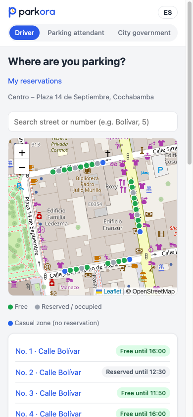
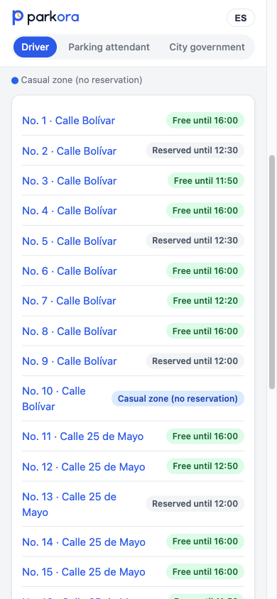
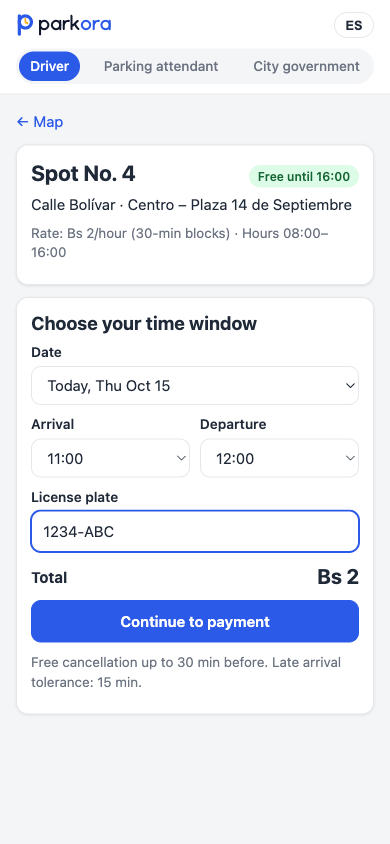
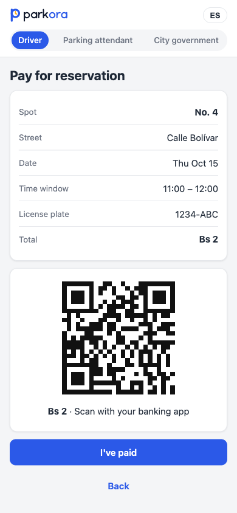
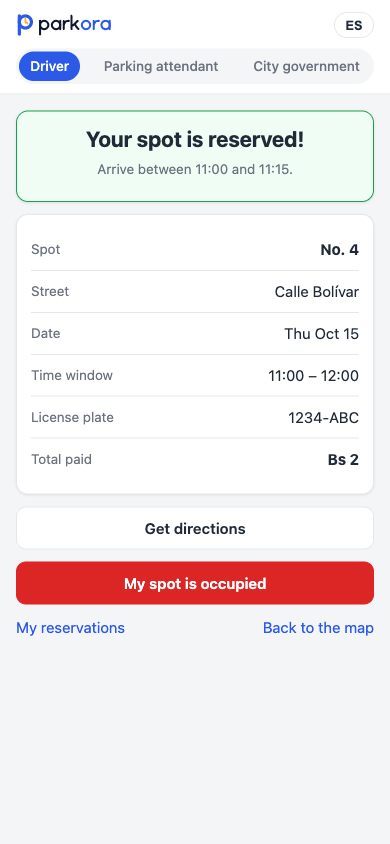
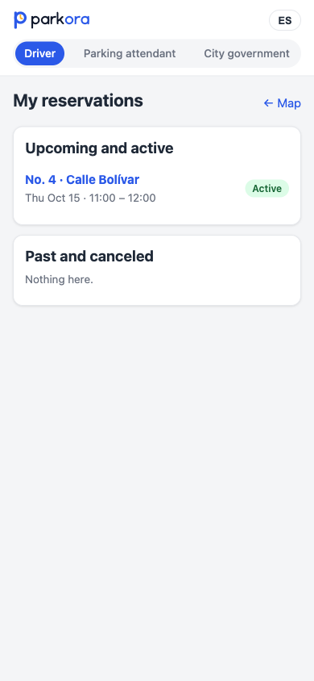
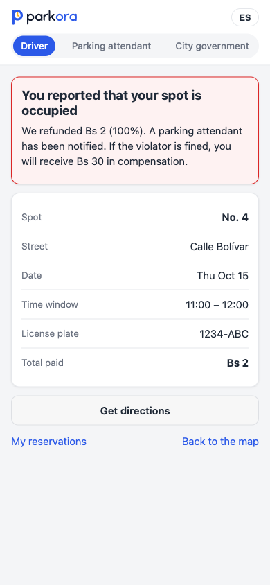
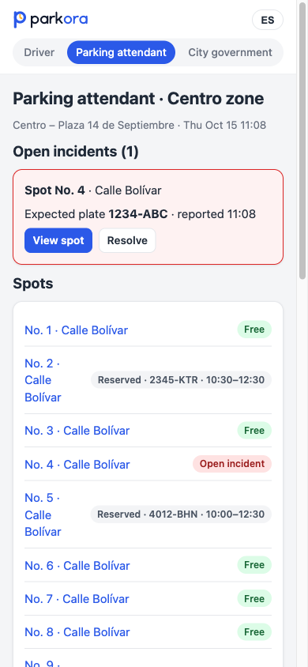
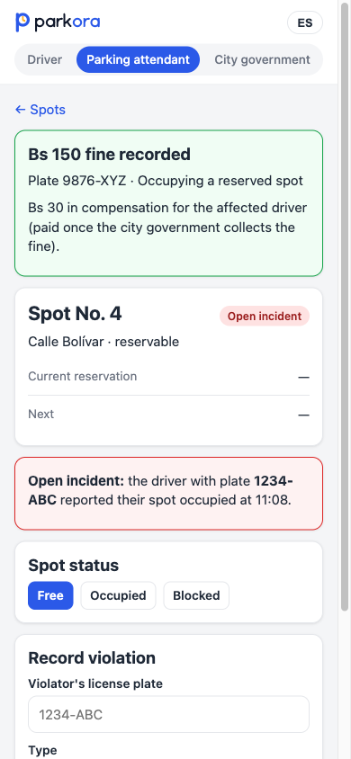
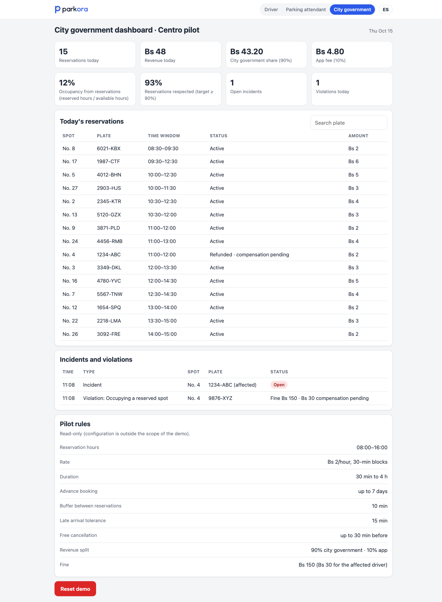

# Parkora: plan

**Date:** 2026-10-14 · **Market:** Latin America and beyond · **Survey and MVP pilot:** Cochabamba, Bolivia

**Parkora** lets drivers **reserve an on-street parking spot** (public streets managed by the city government) for a date and time window. They arrive knowing they have somewhere to park.

*Name:* park + *hora* (Spanish for "hour"): your reserved hour. Works in English and Spanish.

- For any city with an on-street parking problem. Cochabamba is only the survey and pilot location.
- Rates, fines, and zones are set by each city and vary a lot. Bs (Bolivian boliviano) figures are the Cochabamba example.
- Detail: [evidence.md](evidence.md) (survey, results, competitors, sources).

---

## 1. Who it's for, the problem, and how they solve it today

| Customer | Role | What they gain |
|---|---|---|
| **Driver** | End user. Reserves and pays in the app. | Parking in hard areas without circling or leaving hours early. |
| **City government** (*alcaldía*) | Approves and pays (B2G). Owns the street; sets rates, fines, zones. | Less circling traffic, payment in advance, occupancy data by street and hour. |

**Target driver (after the survey):** a private driver who goes at least weekly to a hard-to-park area and stays **1 to 4 hours**. Taxi drivers and short stops are out.

**Problem:** in downtown, market, hospital, and university areas, drivers circle or park far away. They lose time and **add congestion**. They can't know in advance if a spot will be free.

**Today (survey, n = 7):** circle (6/7), leave earlier (5/7), park far (5/7), private lot (3/7), taxi / *trufi* (shared minibus) / *micro* (bus) (1/7), avoid going (1/7). Last visit: **2/7 found no spot and left**; the rest took 5 to 20 min. *Cuidacoches* (informal car watchers) watch the car but don't guarantee a spot. [Costs of each alternative](evidence.md#c3-the-status-quo-the-drivers-real-competition).

---

## 2. Competitors and why someone would choose Parkora

**We found no on-street reservation for private drivers.**

| Type | Examples | Reserve on the street? |
|---|---|---|
| Municipal **payment** apps (Bolivia) | Innova Cochabamba, Mis Cuentas | ❌ Pay once you've found a spot |
| **Payment** apps (region, world) | Blinkay, ZPP Bogotá, PayByPhone, EasyPark, ParkMobile | ❌ Pay only |
| **Reservation** apps | SpotHero, ParkWhiz, JustPark, ParkMobile (SF garages), Estacionate and YaLlegOK (Argentina) | ❌ Private lots / garages only |
| **Logistics** reservations | Coord (Aspen pilot), Parkunload | ❌ Loading zones for delivery drivers only |

**Why choose it** ([detail](evidence.md#c4-why-someone-would-choose-parkora)):
- **Driver:** a guaranteed spot near the destination, at street prices, *before* leaving home.
- **City:** prepaid reservations, occupancy data, and control of rates, zones, and fines (vs. private operators, as in La Paz, suspended by the courts in 2025).

**Risk:** a city may build reservations into its own app (Cochabamba has one). So Parkora is a module **integrable with the city's app in the future** (out of MVP scope), not a rival. [Sources](evidence.md#c-competitor-research).

---

## 3. The experiment, what I learned, and what I'm still assuming

**Biggest assumption:** **the city government wants to implement it**. Not testable in a week, so I tested **drivers** first: without their problem, there's no point going to the city.

**Experiment:** online survey of Cochabamba drivers (Google Forms via WhatsApp). Behavior questions first, app not mentioned. Criteria set **before** responses. **7 responses** (target 30+), probably my close circle: a signal, not proof. [Questions](evidence.md#a-survey-questions-and-scoring) · [full results](evidence.md#b-survey-results).

| # | Criterion (set beforehand) | Result | Verdict |
|---|---|---|---|
| 1 | ≥60% go ≥1×/week to an area where they lose ≥10 min | 3/7 (43%) | ❌ Fails |
| 2 | ≥50% know arrival and departure ≥30 min ahead | 6/7 (86%) | ✅ Passes |
| 3 | ≥40% would pay the same or more for a guaranteed spot | 6/7 (86%) | ✅ Passes |
| — | Commitment: leave their WhatsApp | 0/7 | ⚠️ Warning |

### Criterion 1 failed

- **Pre-set action:** drop the idea or narrow to a niche (e.g., hospitals only).
- **Chosen path:** re-test with a corrected survey. If it fails again → **narrow to the most critical areas or times**.
- **Why not drop it now:**
  - Very small sample (n = 7): each respondent moves the result ~14 points.
  - The pain is real: 7/7 go weekly, 6/7 circle, 2/7 found no spot.
  - 4/7 answered "5 to 10 min", an option touching the 10-min threshold, so the survey can't tell if they pass.
  - The threshold was probably too demanding, and the value seems to be certainty, not minutes.

### What I learned

1. **Certainty beats minutes.** 6/7 rated it 5/5 and would pay the same or more ("quite a bit more, if it really guarantees me the spot", translated from Spanish). The exception is a taxi driver, outside the segment.
2. **Reserving fits how they plan:** most decide hours ahead and roughly know when they'll leave.
3. **Top concern: the reservation not being respected** (4/6 comments).
4. **Stays are 1 to 4 hours,** not 1, so revenue was recalculated (section 5).
5. **Areas:** Centro has the most mentions (7 of 24); La Cancha (6), universities (6), and hospitals (5) too.

**How the plan changed:**
- MVP scope: **Centro only**. Other areas are expansion candidates.
- Message: **"arrive with your spot guaranteed"**, not "save time".
- Enforcement, refund, and compensation become core.
- The survey reinforced an earlier decision: keep **casual zones (no reservation)** for occasional drivers, taxis, and short stops.

**Still assuming:** the city wants it (untested) · stated interest becomes real payment (0/7 left WhatsApp) · drivers pay digitally (only 20% used Cochabamba's parking app in March 2025) · results hold outside my circle and in other cities · parking attendants can enforce and fines deter · *cuidacoches* won't push back · reservations + casual zones beats 100% reservable.

---

## 4. Smallest useful version, mockup, and how it would be built and tested

**MVP:** a web app (nothing to install) for 2 or 3 blocks of Centro Cochabamba. Drivers pick a spot, see **until what time it's free**, reserve a time window, and pay (QR). Parking attendants check plates and mark spots occupied. The city gets a dashboard.

**Driver flow** (clickable prototype in [web/](web/), open `web/index.html`):

| 1. Search | 2. Free spots | 3. Time window | 4. Pay (QR) | 5. Confirmation |
|---|---|---|---|---|
|  |  |  |  |  |

**Reservation not respected and enforcement:**

| My reservations | Spot occupied → refund | Attendant: spots | Attendant: fine |
|---|---|---|---|
|  |  |  |  |

**City government dashboard:**

**Build and test:**
1. **Before the city:** landing page with pre-registration and a simulated reservation. Success: ≥10% of visitors leave their contact.
2. **Pilot with the city:** 2 or 3 blocks of Centro, numbered and signposted spots, attendants using the control view, 4 to 8 weeks. Targets: ≥90% of reservations respected, ≥30% of drivers reserve again.

---

## 5. Pricing, marketing, and first paying customers

### Pricing

| Who pays | What | Amount |
|---|---|---|
| Driver | Parking rate, set by each city | Varies by city and country. Cochabamba MVP: **Bs 2/hour** (official). Survey: room for the same or slightly higher (6/7); the city decides. |
| City → Parkora | Commission on each reservation | 2% to 10%; **10% is the current proposal** (includes development, maintenance, operations) |
| City → Parkora | Upfront implementation fee (zones, spot inventory, integration, training) | Pending negotiation; assumed **~US$10,000** |

**Fines:** set by the city, much higher than a reservation, for taking a reserved spot or overstaying. An indirect outcome, not the pitched revenue. The affected driver gets a **100% refund right away**, plus part of the fine once collected (Cochabamba example: Bs 150 fine → Bs 120 city, Bs 30 driver).

### Estimate per city (Cochabamba example)

| Variable | Assumption |
|---|---|
| Spots in reservation zones | 2,000 *(confirm with the city government)* |
| Charging hours | 8 h/day (8:00 to 16:00) |
| Average occupancy | 75% |
| Rate | Bs 2/hour |
| Daily volume | 2,000 × 8 × 0.75 × Bs 2 = **Bs 24,000** |
| Parkora commission (10%) | **Bs 2,400/day ≈ Bs 52,800/month** (22 working days) ≈ **US$ 7,600/month** |

- Plus the one-time fee (~US$10,000, assumed).
- About 4× below the first estimate, which assumed 10 one-hour reservations per spot per day.
- Varies a lot with each city's rate. Bs 2/h is low, and drivers said they'd pay the same or more.
- QR payment fees may cut the margin (to be confirmed).

### Marketing and first customers

The model is B2G: **the first paying customer is a city government.**
1. **Cochabamba city government** (Movilidad Urbana, the urban mobility department): show the survey, propose a pilot in 2 or 3 blocks of Centro. Pitch: less congestion, secured payment, occupancy data, no control lost to private operators.
2. **Drivers:** city channels (social media, municipal app), pilot-street signage ("this spot is reserved through the app"), attendants, WhatsApp groups.
3. **Next cities:** pilot results (less circling, occupancy, revenue) as the case study, in Latin America and beyond.

---

## 6. What I'd test next and what would make me change direction

| Next test | Validates | Result that changes direction |
|---|---|---|
| **Meeting with Cochabamba's city government** | Assumption #1 | No pilot, or reserving public space isn't legal → **pivot to private parking** (garages, lots). |
| **Landing page with pre-registration** | Interest becomes action | <**10%** leave details → pivot to **real-time availability** (no reservations), or a narrower niche (e.g., hospitals only). |
| **Corrected survey outside my circle** (30+ responses, ranges not touching 10 min) | Criterion 1: frequent pain | Still <60% losing ≥10 min → **narrow to the most critical areas or times.** |
| **Other cities and countries** (La Paz, Santa Cruz, then Latin America) | The problem repeats | Only exists in Cochabamba → the business is local and the commission model can't scale. |

**Why only Cochabamba now:** it's where I can reach drivers. Next: other cities in Bolivia, Latin America, and beyond.
